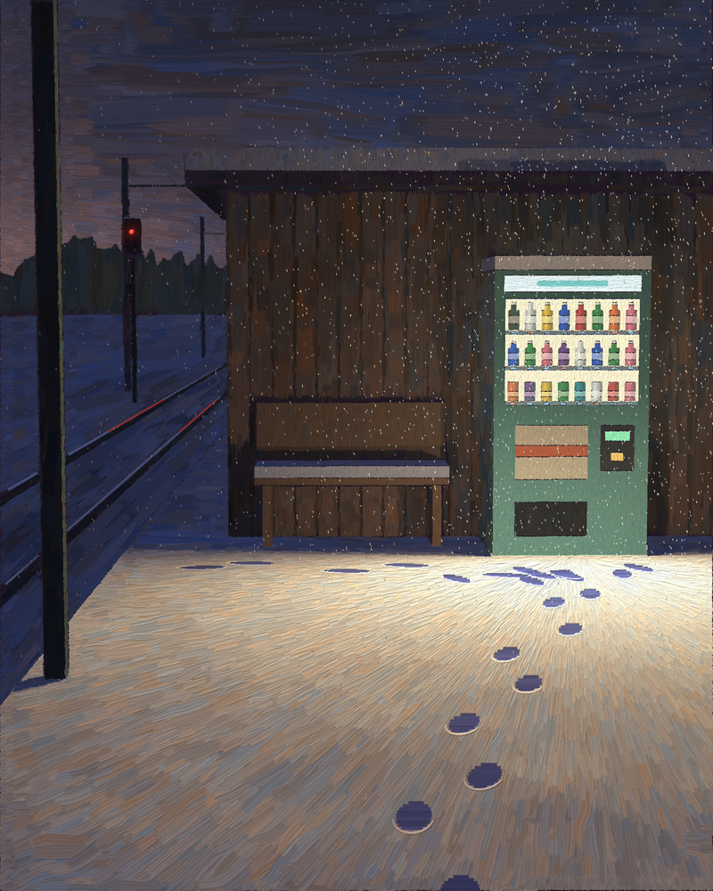

# Atelier

A painting studio in code, and an experiment in whether a culture can be simulated.



*The 11:52 Has Gone* — Odile Marsh, no. 1. 73,581 simulated brush strokes. No image model was used: the picture is the output of a Python program.

## The idea

Language models can paint by writing code: a program that lays down tens of thousands of brush strokes, one decision at a time. Asked to paint as itself, a model tends to imitate existing art. Asked to first develop a **persona** — an artist with a subject, a method, and rules they keep — it produces work that is more consistent and more its own.

This project takes that one step further. If one persona can hold a style, what happens with many of them, over time, in contact with each other?

**The goal is to simulate a small art world and watch a culture develop in it**: artists who make work, see each other's work, argue about it, form schools, break from them, age, teach, and are succeeded by people who grew up looking at what they made.

The project was prompted by Jake Eaton's public experiments in painting with Claude through code and personas.

## Goals

1. **A studio good enough to be worth looking at.** A brush engine where every mark is a simulated stroke, so paintings read as paintings and not as filtered renders.
2. **Artists as persistent people.** Each artist is a persona with a subject, rules, a memory of what they have made and seen, relationships, and a personal toolbox of technique.
3. **A society, not a gallery of soloists.** Time runs in seasons: studio work, open-studio critiques where artists look at each other's actual images, curated group shows, reviews, and the responses those provoke.
4. **Lives and generations.** Artists change periods, teach, stop, and die. New artists arrive having seen what came before.
5. **Influence you can trace.** Paintings are source code. When one artist borrows another's technique, it is visible in the code, so lineage can be measured rather than only claimed.
6. **A museum you can walk through.** A web gallery with a room per exhibition, hung in order, with wall texts, the critiques behind each work, and a map of who influenced whom.

The open question underneath all of it: does anything that deserves the word *culture* emerge — movements, reactions, drift, taste — or do the artists collapse toward one house style?

## Status

Built:

- the brush engine
- a small raytracer used only to make lighting studies for the painter to work from
- a reference-driven painter whose "hand" is a data object
- one persona, [Odile Marsh](personas/odile_marsh.md)
- one painting, [`paintings/marsh_001.py`](paintings/marsh_001.py)

Not built yet: the multi-artist simulation, critiques and exhibitions, generations, lineage tracking, and the museum.

## How a painting is made

1. **Study.** The scene is described as simple boxes and lights. A raytracer works out where things are and how light falls. This is the painter's reference, never the picture.
2. **Block-in to detail.** The painter makes several passes with smaller and smaller brushes. On each pass it looks for places where the canvas still differs from the study and lays a stroke there, following the direction of the form and lifting off where the subject changes.
3. **Handling.** How loaded the brush is, how far a stroke runs, how much colour wanders between strokes — these are the artist's hand, set per persona.
4. **By hand.** Details the passes cannot find are placed stroke by stroke: footprints, falling snow, wires, a far signal light.
5. **Varnish.** Paint thickness is tracked as a height map and lit from the side, so thick passages catch light.

A persona's rules become code. Marsh's rule that light is "combed outward from its source" is a direction field that points every stroke in the lit zone away from the lamp.

## Run it

Requires [uv](https://docs.astral.sh/uv/).

```sh
uv sync
uv run python paintings/marsh_001.py
```

The painting is written to `out/marsh_001.png`. The first run takes longer while the engine compiles.

## Layout

| Path | What it is |
| --- | --- |
| `src/atelier/brush.py` | Bristle stroke rasterizer, canvas, varnish |
| `src/atelier/rt.py` | Box raytracer, camera, noise, for studies |
| `src/atelier/painter.py` | Reference-driven painting passes and `Handling` |
| `personas/` | One file per artist: subject, rules, works |
| `paintings/` | One script per painting |
| `out/` | Finished paintings |
